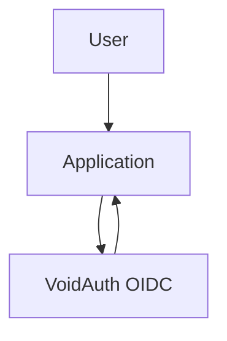

# SSO with VoidAuth

VoidAuth is the SSO provider for Spruce infrastructure.

```txt
https://github.com/voidauth/voidauth
```

It can act as:

- OIDC provider
- Proxy ForwardAuth provider
- LDAP directory server

## Recommended integration model

Use native OIDC wherever possible:



Use proxy/forward auth only for apps that do not support OIDC and only when it will not break public paths, callbacks, webhooks, or APIs.

## Service notes

### Portainer Business Edition

Use Portainer's external authentication/OIDC settings and create a VoidAuth OIDC app for Portainer.

Suggested redirect URL:

```txt
https://portainer.willowidk.dev
```

Confirm the exact callback path in Portainer's authentication settings before creating the client in VoidAuth.

### Nginx Proxy Manager

Nginx Proxy Manager does not provide native OIDC for its admin UI. Recommended options:

1. Keep NPM admin on a private network such as Tailscale and keep NPM's own login.
2. Put a separate auth-capable reverse proxy in front of NPM admin.

Avoid making NPM depend on itself for admin authentication unless you are comfortable with the bootstrap/recovery risks.

### CalNode

CalNode provides its own authentication and Google/Microsoft OAuth calendar callbacks. Avoid blanket proxy auth in front of `calnode`, because public booking pages and calendar callbacks need unauthenticated access.

### Static sites

For private static sites, proxy auth can work well. For public sites, do not add SSO.
